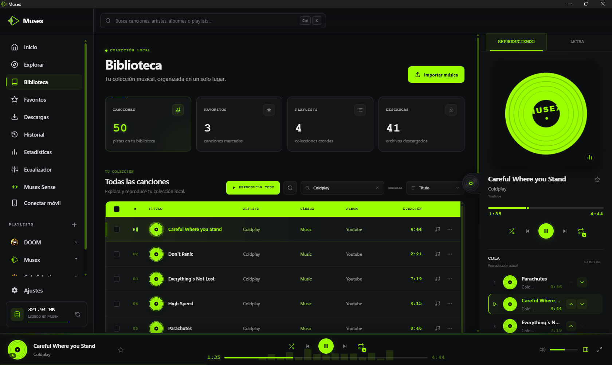
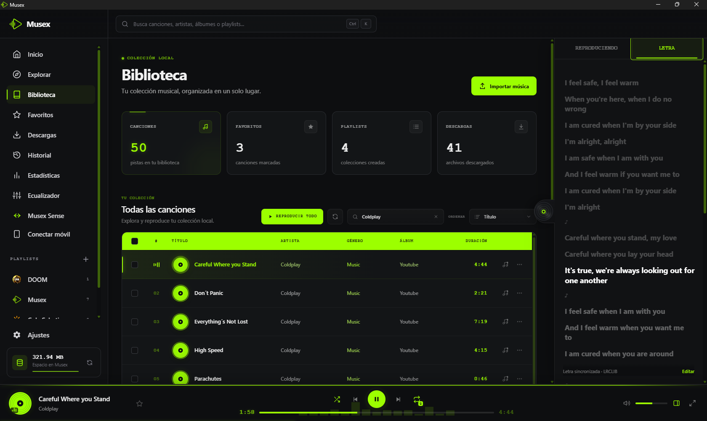
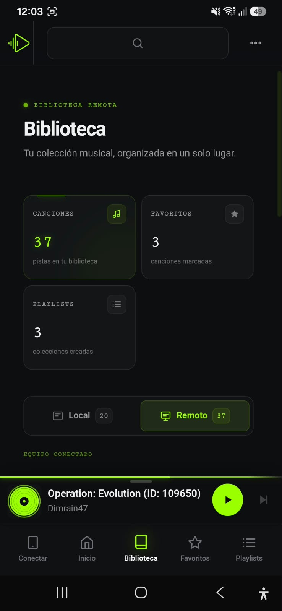

  

  <h1>Musex</h1>

  

    Un espacio de trabajo musical local construido con Angular, Tauri y Rust.
  

  

  

---

## Acerca de

Musex es un espacio de trabajo musical enfocado en la gestión, reproducción y descubrimiento de música local. Funciona en **Windows** como aplicación de escritorio completa y en **Android** como complemento pensado para escuchar tu música desde el teléfono.

> **Estado:** versión *alpha*. Hay funciones en evolución y pueden aparecer errores. Si encuentras alguno, abre un *issue*.

Las notas de cada versión (qué cambia, instaladores y capturas) están en la sección de [**Releases**](../../releases) del repositorio.

## Características

### Reproducción y biblioteca

- Biblioteca musical local con búsqueda, favoritos y listas de reproducción.
- Cola de reproducción con su propio panel: tarjeta de *Reproduciendo ahora*, duración total y vaciado de la cola.
- Reproductor completo con menú de opciones de la canción, cola con desplazamiento y manejo de títulos largos.
- **Letras sincronizadas** en el panel *Reproduciendo*: la línea actual se resalta y se mantiene centrada, y al tocar una línea el reproductor salta a ese momento. También puedes pegar o escribir tu propia letra.
- Edición de metadatos (título, artista, álbum, género) que **se conserva** al reiniciar o volver a escanear la biblioteca, con opción de *restaurar el original*. Los archivos de audio no se modifican.
- Portadas locales y portada predeterminada de Musex.

### Historial y estadísticas

- **Historial unificado**: reproducción, descargas y selecciones del auto-picker en una sola línea de tiempo agrupada por día, con filtros.
- **Estadísticas de escucha**: tiempo real escuchado, reproducciones, artistas, canciones, álbumes y géneros más escuchados, racha de días y gráficas por hora y por día de la semana. Se filtran por semana, mes, año o siempre.
  - Una canción cuenta como reproducción si la escuchas al menos 30 segundos (o la mitad, si es corta).
  - Los datos se guardan solo en tu dispositivo.

### Ecualizador

- Ecualizador paramétrico con **curva de respuesta interactiva**: arrastra cada banda para cambiar su frecuencia y ganancia, y usa la rueda del ratón para ajustar la Q.
- **Presets integrados** (Graves, Voces, Brillo, Rock, Electrónica, Volumen bajo).
- Margen de volumen automático que compensa los refuerzos para evitar la saturación.
- Los cambios de banda no producen chasquidos, y los valores se limitan a los rangos reales del motor.
- Asistencia de ecualización con **Musex Sense**.

### Descargas (escritorio)

- Descarga de audio desde YouTube y, cuando la fuente lo permite, desde Newgrounds, con conversión automática a MP3.
- **Varios enlaces a la vez**: pega uno por línea.
- **Listas de reproducción de YouTube**: se expanden en sus videos y se descargan en cola.
- Las descargas se procesan **una por una**, y se pueden cancelar también las que ya están en curso.
- Integración de `yt-dlp` y FFmpeg incluida con la aplicación.

### Auto-picker

- Al terminar una canción elige la siguiente según tu biblioteca y tu historial, con un tiempo de gracia para confirmarla o cancelarla.
- Cada decisión queda registrada en el historial: reproducida, adelantada, cancelada o reemplazada.
- En Android, la elección se confirma desde una **notificación propia** con las acciones *Reproducir ahora* y *Cancelar*, y la app se mantiene activa mientras se espera.

### Explore y Musex Sense

- **Musex Sense** es el sistema de asistencia inteligente de Musex y usa **Google Gemini** con tu propia API Key. Sus capacidades se activan y desactivan por separado: recomendaciones y asistencia para el ecualizador.
- **Explore** guarda las recomendaciones, que ya no se pierden al cambiar de página, y se pueden filtrar por día, semana, mes, año o siempre.
- **Recomendar algo nuevo** pide a Sense canciones basadas en tu historial **sin repetir** las anteriores. Sin historial de escucha no genera nada.
- **Enlaces verificados**: añade enlaces de YouTube y Newgrounds. Los de YouTube se comprueban en línea (existencia y título); los de Newgrounds solo se valida el formato.
- Las sugerencias de Sense son generadas por un modelo de IA y **no están verificadas**: pueden contener errores.

### Windows: segundo plano y controles del sistema

- Controles multimedia de Windows con título, artista, portada y barra de progreso (superposición de volumen, pantalla de bloqueo y teclas multimedia).
- Icono en la **bandeja del sistema** con *Reproducir/Pausar*, *Anterior*, *Siguiente* y *Salir*.
- Si cierras la ventana con música sonando, Musex **sigue en segundo plano**. Con la música en pausa, se cierra normalmente.

## Musex para Android

  <!-- Sustituir por la captura real de Android -->
  

La versión Android conserva la identidad visual de la de escritorio y se centra en la biblioteca, la reproducción y las listas de reproducción, con una interfaz adaptada a pantallas táctiles.

- Notificación de reproducción con controles y pantalla de bloqueo.
- Confirmación del auto-picker desde una notificación especial.
- Estadísticas, historial y editor de metadatos adaptados al móvil.
- Sincronización de listas de reproducción con el escritorio, según las funciones disponibles.

Las herramientas de descarga y procesamiento son propias de Windows y no están disponibles en Android.

## Tecnologías

* Angular
* Tauri
* Rust
* TypeScript
* Tailwind CSS
* `yt-dlp` y FFmpeg (descargas y conversión)
* Google Gemini (Musex Sense)
* LRCLIB (letras)

## Privacidad

- La biblioteca, el historial, las estadísticas y las recomendaciones se guardan **en tu dispositivo**.
- Musex Sense envía a Gemini información de tu biblioteca y de tu historial reciente solo cuando usas sus capacidades, con la API Key que tú configuras.
- Las letras se buscan en LRCLIB enviando el título, el artista, el álbum y la duración de la canción.
- La verificación de enlaces de YouTube consulta el servicio *oEmbed* de YouTube.

## Configuración recomendada del entorno

[VS Code](https://code.visualstudio.com/) + [Tauri](https://marketplace.visualstudio.com/items?itemName=tauri-apps.tauri-vscode) + [rust-analyzer](https://marketplace.visualstudio.com/items?itemName=rust-lang.rust-analyzer) + [Angular Language Service](https://marketplace.visualstudio.com/items?itemName=Angular.ng-template)

---

**Musex — Tu música, tu biblioteca, tu espacio.**